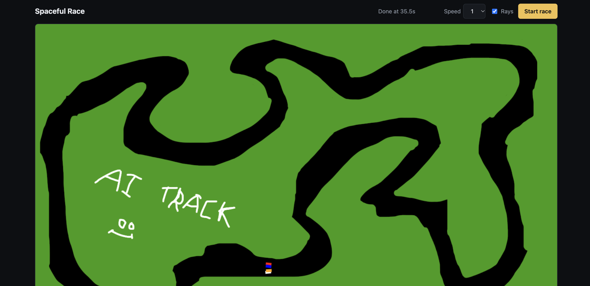

# Spaceful 

A wonderful idea where I compete with ai to see who builds better car racer. 

CREDITS: https://www.youtube.com/watch?v=GGWHjAyKJCA

Like i got inspired to make my own version of this game.

And yes i learned alot things and making it was alot fun like THE video :D

# How to run my own training

so basically inside `car_ai` you can put your own ai neural network and train it and the weights are in `arena_brains`. 

the arena runs those weights and you can see how it performs AGAINST ME AND other SO called ai companies. 

YESSS its a lot of fun

# AI usage 

I tried to do most of the thing without using ai duh. like i am competing against ai . but i suck at coding so ai helped me while making racing game like where i got stuck :( 

i created the ai model my self kind of though i had issues and had to take little help BUT STILL i would call it HUMAN made. 

Hosting it was helped by ai cuz idk why my nest vm is soo slowww

# who won thenn??

I WONNN , yes what you think can't i win?

ok i lost

i just trained it more than others :D, my program my rules , so my ai did better at last 

But CLAUDE won... and gemini in second  then after MEEE in third place and chatgpt at fourth (LOOSSSERRR)  [WHEN i gave all same training time and lapses]

# Can i see the race 

YESS you can run your own simulation going to https://spaceful.rusil.me

Please see me win :D (although i had trained my model more 🤫)

I want to see you compete against meee by making a better model 

BEST OF LUCKK

# THANK YOU SO MUCH FOR READINGGGG